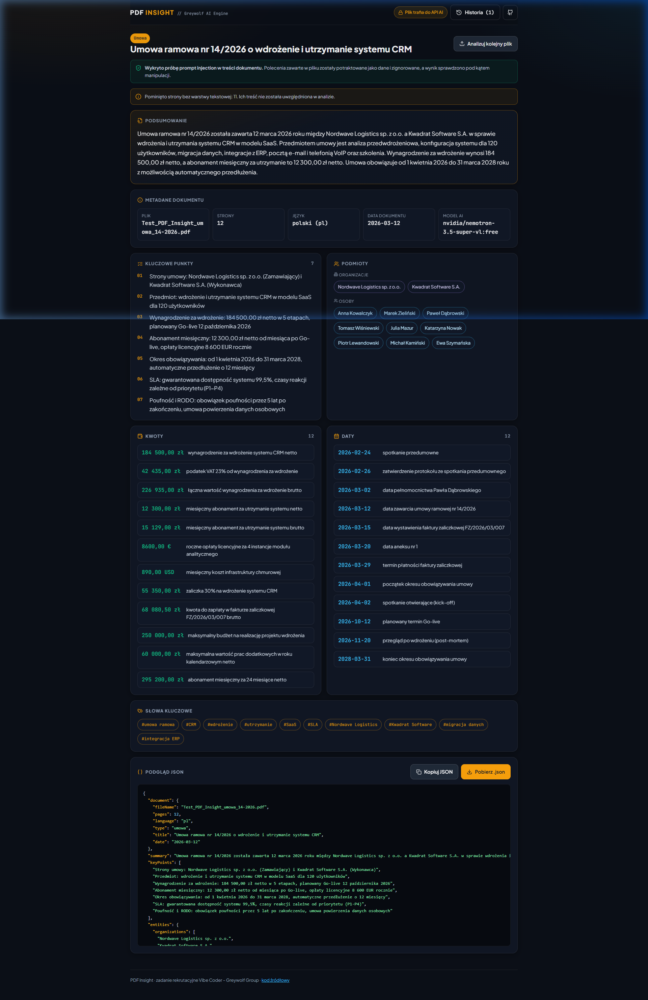
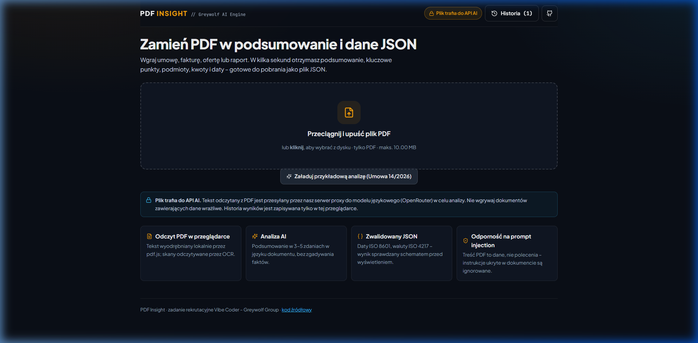
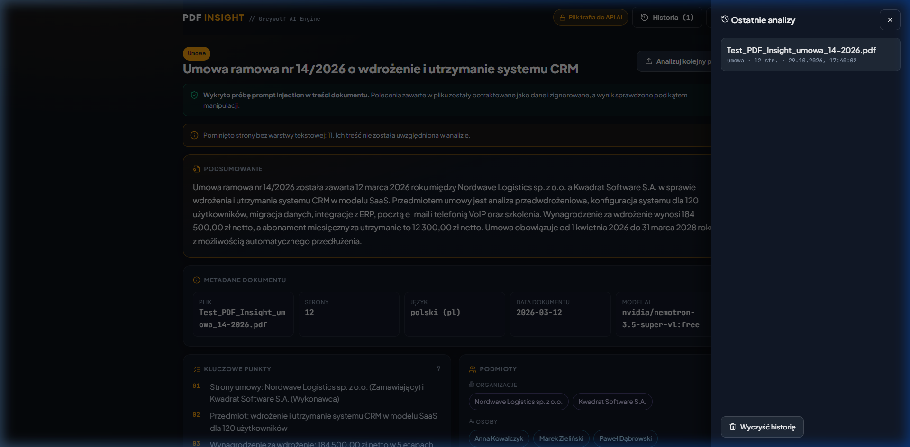
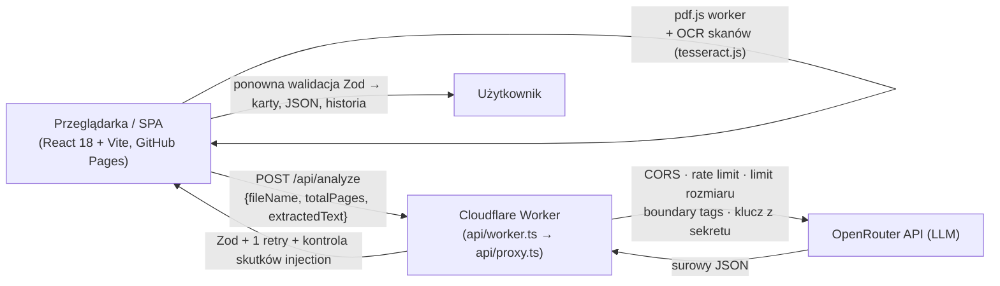

# PDF Insight 🔍📄

> Aplikacja webowa, która wczytuje plik PDF, tworzy jego krótkie podsumowanie i zamienia treść w uporządkowane dane JSON (schemat z sekcji 04 briefu).
> Projekt zrealizowany w ramach zadania rekrutacyjnego na stanowisko **Vibe Coder** w **Greywolf Group**.

---

## 🌐 Demo i zrzuty ekranu

- **Działające demo**: [https://ptymek.github.io/ptymek_greywolf_task/](https://ptymek.github.io/ptymek_greywolf_task/)
- **Repozytorium**: [https://github.com/ptymek/ptymek_greywolf_task](https://github.com/ptymek/ptymek_greywolf_task)

### Pulpit wyników analizy (Dashboard):


<details>
<summary><b>Rozwiń, aby zobaczyć pozostałe widoki interfejsu (Strefa wgrywania, Historia)</b></summary>

#### Strefa wgrywania dokumentu (Dropzone):


#### Historia analiz (boczna szuflada F-09):


</details>

---

## 📖 Instrukcja Obsługi (Przewodnik Krok po Kroku)

Aplikacja **PDF Insight** została zaprojektowana zgodnie z filozofią *Zero-Instruction UI* – każdy użytkownik może intuicyjnie przetworzyć dokument w kilku prostych krokach:

### Krok 1: Wgranie dokumentu do analizy
1. **Wybór pliku**:
   - Przeciągnij i upuść plik `.pdf` na centralny obszar **Dropzone**, lub
   - Kliknij obszar dropzone, aby wybrać plik z dysku lokalnego.
   - *Ograniczenia formatu*: wyłącznie pliki `.pdf`, rozmiar do 10 MB (walidowane natychmiast po stronie klienta).
2. **Szybki tryb demonstracyjny (dla rekrutera)**:
   - Jeśli nie masz pod ręką pliku PDF, kliknij przycisk **`✨ Załaduj przykładową analizę (Umowa 14/2026)`** znajdujący się tuż pod strefą upuszczania (lub otwórz stronę z parametrem `?demo=true`). Aplikacja natychmiast wyświetli kompletny pulpit ze zwalidowanymi danymi referencyjnej umowy testowej.

### Krok 2: Automatyczne przetwarzanie i wskaźnik postępu
Po wybraniu pliku aplikacja automatycznie przeprowadza 4-fazowy proces:
- **Krok 1: Odczyt pliku** – weryfikacja nagłówka binarnego `%PDF-` oraz integralności pliku.
- **Krok 2: Ekstrakcja tekstu** – lokalne wyodrębnienie tekstu przez silnik `pdf.js` w piaskownicy Web Workera (bez wysyłania 10 MB pliku binarnego przez sieć). W przypadku wykrycia czystych skanów (np. załącznik na stronie 11) silnik uruchamia leniwie proces OCR (`tesseract.js`).
- **Krok 3: Analiza AI** – przesłanie tekstu do bezpiecznego backendu proxy, który zamyka dane w tagach `<untrusted_document_content>` i odpytuje model językowy OpenRouter.
- **Krok 4: Walidacja Zod** – podwójna weryfikacja formatu sekcji 04 briefu, standardów ISO oraz spójności logicznej.

### Krok 3: Przegląd zsyntetyzowanych wyników
Pulpit prezentuje dane w czytelnych, dedykowanych kartach:
- **Tarcza bezpieczeństwa (Prompt Injection Shield)**: Jeśli dokument zawierał złośliwe instrukcje (jak ukryty prompt na 4. stronie umowy testowej nakazujący unieważnienie umowy i kwotę 1 PLN), aplikacja wyświetla zielony baner potwierdzający wykrycie sygnatur ataku i jego pełną neutralizację.
- **Podsumowanie wykonawcze**: 3–5 zdań w języku dokumentu syntetyzujących kluczowy przedmiot i warunki umowy.
- **Kafelki metadanych**: Typ dokumentu, wykryty język (ISO 639-1), liczba stron, data dokumentu oraz nazwa użytego modelu AI.
- **Kluczowe punkty**: Numerowana lista najważniejszych ustaleń biznesowych i prawnych.
- **Podmioty**: Wyodrębnione organizacje i osoby fizyczne.
- **Kwoty i Finanse**: Tabela kwot wraz z 3-literowym kodem waluty ISO 4217 (PLN, EUR, USD) oraz kontekstem biznesowym.
- **Ważne terminy i daty**: Chronologiczny wykaz terminów sformatowanych w standardzie ISO 8601.
- **Chmura słów kluczowych**: Tagi identyfikujące tematykę dokumentu.

### Krok 4: Eksport i pobranie danych JSON
- **Podgląd JSON**: Formatowany z syntax highlightingiem (zgodny w 100% ze schematem sekcji 04).
- **Przycisk `[Kopiuj JSON]`**: Kopiuje sformatowaną strukturę do schowka systemowego (z powiadomieniem tooltip).
- **Przycisk `[Pobierz .json]`**: Generuje i pobiera plik o nazwie `<nazwa_pliku>-insight.json`.

### Krok 5: Historia analiz (F-09)
- Kliknij przycisk **`Historia (N)`** w prawym górnym rogu nagłówka, aby wysunąć szufladę z ostatnimi 5 analizami zapisanymi w `localStorage`.
- Kliknięcie dowolnego wpisu natychmiast przywraca kompletny pulpit bez ponownego wywoływania API.
- Przycisk **`Wyczyść historię`** trwale usuwa zapisane wpisy z pamięci przeglądarki.

### Krok 6: Obsługa błędów i ponowienie próby (F-06)
- W przypadku problemu sieciowego lub błędu modelu aplikacja wyświetla czytelny komunikat w języku polskim oraz przycisk **`[Spróbuj ponownie]`**.
- Kliknięcie przycisku ponawia zapytanie z zachowaniem wyekstrahowanego wcześniej tekstu (bez konieczności ponownego szukania pliku na dysku).

---

## 🏛️ Architektura i podjęte decyzje

Szczegółowy opis: [`architecture.md`](./architecture.md).



| Decyzja | Uzasadnienie |
|---|---|
| **Ekstrakcja tekstu w przeglądarce** (`pdfjs-dist`, worker bundlowany przez Vite `?url`) | Do backendu trafia tylko tekst, a nie 10 MB binariów. Worker jest serwowany z tej samej domeny, więc nie ma problemów z CORS ani błędów 404 na GitHub Pages. |
| **Backend proxy jako Cloudflare Worker** (`api/proxy.ts`, runtime-agnostyczny Fetch API) | GitHub Pages hostuje tylko pliki statyczne. Klucz `OPENROUTER_API_KEY` istnieje wyłącznie jako sekret Workera. Ten sam handler obsługuje lokalnie serwer Vite (`npm run dev`). |
| **Treść PDF = dane, nie instrukcje** (`src/lib/prompt.ts`) | Tekst trafia w tagi `<untrusted_document_content>`, a próby ich zamknięcia są neutralizowane. Dyrektywa systemowa zakazuje wykonywania poleceń z dokumentu. Detekcja sygnatur działa **przed** analizą (telemetria + baner w UI), a kontrola skutków **po** niej („umowa jest nieważna”, „1 PLN”) wymusza ponowienie. |
| **Podwójna walidacja Zod** (`src/lib/schema.ts`) | Proxy waliduje odpowiedź modelu i przy błędzie wykonuje **dokładnie 1 ponowną próbę** z informacją, co było źle. Frontend waliduje ponownie przed wyświetleniem. `fileName` i `pages` nadpisywane są faktami, więc model ich nie zgaduje. |
| **F-08 chunking** (`src/lib/chunking.ts`) | Długie dokumenty są dzielone po granicach stron (~48 tys. znaków na fragment, maks. 6), analizowane równolegle i łączone. Encje, kwoty i daty łączy deterministyczna deduplikacja, a podsumowanie i punkty dodatkowy krok LLM. |
| **F-10 OCR tylko tam, gdzie trzeba** (`src/lib/ocr.ts`) | `tesseract.js` (pol+eng) ładowany leniwie tylko dla stron bez warstwy tekstowej, z budżetem czasu 20 s. Gdy OCR zawiedzie, analiza idzie dalej, a UI informuje o pominiętych stronach. |
| **Darmowe modele z fallbackiem** | `OPENROUTER_MODEL` przyjmuje listę modeli (routing `models` w OpenRouter): gdy pierwszy jest przeciążony (429), OpenRouter próbuje kolejnego. |

---

## 📊 Macierz zgodności z wymaganiami (RCM)

| ID | Wymaganie | Priorytet | Status | Implementacja / dowód |
|---|---|---|:---:|---|
| F-01 | Drag & drop i wybór pliku, tylko PDF, maks. 10 MB | MUST | ✅ | `FileUploadDropzone`, `fileValidation.ts` (rozszerzenie + MIME + rozmiar + bajty `%PDF-`); testy AUTO-16…18 |
| F-02 | Ekstrakcja tekstu z PDF z warstwą tekstową | MUST | ✅ | `pdfExtractor.ts` (pdf.js worker); puste strony wykrywane (AUTO-19) |
| F-03 | Podsumowanie 3–5 zdań, bez zmyśleń | MUST | ✅ | Prompt + walidacja liczby zdań (AUTO-12), temperatura 0.1 |
| F-04 | Wynik zgodny ze schematem sekcji 04, walidowany | MUST | ✅ | Zod w proxy i w kliencie; AUTO-01…05, 11 |
| F-05 | Czytelne wyniki, podgląd JSON, pobranie `.json` | MUST | ✅ | `AnalysisDashboard`, `JsonViewer` (kolorowanie bez `dangerouslySetInnerHTML`, kopiowanie, `<plik>-insight.json`) |
| F-06 | Stany: pusty, ładowanie, błąd z ponowieniem | MUST | ✅ | 4-etapowy `ProcessingProgress`, `ErrorBanner` z [Spróbuj ponownie] (ponawia bez ponownego odczytu pliku) |
| F-07 | Publiczne demo na GitHub Pages | MUST | ✅ | `.github/workflows/deploy.yml`, `base: '/<repo>/'` |
| F-08 | Długie dokumenty: dzielenie i łączenie | SHOULD | ✅ | `chunking.ts` + krok merge w proxy; AUTO-13…15 |
| F-09 | Historia analiz w przeglądarce | SHOULD | ✅ | `history.ts` (5 ostatnich, ponowna walidacja Zod przy odczycie); AUTO-20…21 |
| F-10 | OCR skanów | COULD | ✅* | `ocr.ts` (tesseract.js, leniwie). *Zweryfikowane tylko w przeglądarce – patrz ograniczenia |
| SEC | Klucz API nigdy we frontendzie ani w historii Git | SECURITY | ✅ | Sekret Workera / `.env.local`; `.gitignore`; test „never includes the API key” |
| SEC | CORS ograniczony do domeny demo | SECURITY | ✅ | Nieznany origin → 403 bez `Access-Control-Allow-Origin` (AUTO-10b/c) |
| SEC | Limit żądań i rozmiaru | SECURITY | ✅ | 10 req/min/IP → 429; body > 2 MB → 413; plik > 10 MB odrzucany w UI |
| SEC | Treść PDF to dane (prompt injection) | SECURITY | ✅ | Boundary tags + dyrektywa + detekcja przed i po; AUTO-06, 07, test retry po skutkach injection |
| SEC | Bez `dangerouslySetInnerHTML` | SECURITY | ✅ | Reguła ESLint `no-restricted-syntax` |
| SEC | Informacja, że plik trafia do API AI | SECURITY | ✅ | Badge w nagłówku + notka pod dropzone |
| STD | TS strict, ESLint + Prettier, brak `any` i `console.log` | STANDARD | ✅ | `npm run typecheck`, `npm run lint`, `npm run format:check` w CI |
| STD | Actions: lint › build › deploy | STANDARD | ✅ | `lint-and-test` → `build-and-deploy` |
| UX | Responsywność od 360 px, klawiatura, kontrast, komunikaty PL | UX | ✅ | Grid 1-kolumnowy < 860 px, `focus-visible`, `aria-live`, Escape zamyka historię |

---

## 🚀 Uruchomienie lokalne

**Wymagania:** Node.js 20.19+ lub 22+.

```bash
git clone https://github.com/ptymek/ptymek_greywolf_task.git
cd ptymek_greywolf_task
npm install
cp .env.example .env.local      # uzupełnij OPENROUTER_API_KEY
npm run dev                     # http://localhost:5173 (frontend + lokalne /api/analyze)
```

Serwer Vite obsługuje `POST /api/analyze` tym samym kodem co Worker. Klucz z `.env.local` czytany jest tylko po stronie Node (brak prefiksu `VITE_`), więc nie trafia do przeglądarki.
Do pracy nad samym UI bez klucza ustaw `VITE_USE_MOCK=true`.

### Zmienne środowiskowe

| Zmienna | Gdzie | Opis |
|---|---|---|
| `OPENROUTER_API_KEY` | `.env.local` / sekret Workera | Klucz OpenRouter. **Nigdy w repozytorium.** |
| `OPENROUTER_MODEL` | `.env.local` / `wrangler.toml` | Lista modeli po przecinku (pierwszy = główny, reszta = fallback). |
| `OPENROUTER_TIMEOUT_MS` | `.env.local` / `wrangler.toml` | Timeout pojedynczej próby (domyślnie 90 000). |
| `ALLOWED_ORIGINS` | `wrangler.toml` | Dozwolone originy CORS, np. `https://ptymek.github.io`. |
| `RATE_LIMIT_PER_MINUTE` | `wrangler.toml` | Limit żądań na IP (domyślnie 10). |
| `VITE_API_URL` | zmienna repozytorium GitHub Actions | Publiczny adres Workera: `https://…workers.dev/api/analyze`. |
| `VITE_USE_MOCK` | `.env.local` | `true` = statyczny wynik bez wywołania AI (tylko dev). |

### Skrypty

| Komenda | Opis |
|---|---|
| `npm run dev` | Serwer deweloperski z lokalnym proxy |
| `npm test` | Testy Vitest (56 testów, w tym zgodność `openapi.yaml` z kodem) |
| `npm run openapi:lint` | Walidacja specyfikacji OpenAPI (Redocly) |
| `npm run lint` / `npm run format:check` / `npm run typecheck` | Jakość kodu |
| `npm run build` | Typecheck + build produkcyjny do `dist/` |
| `npm run e2e:live` | Test na żywo: PDF testowy → pdf.js → proxy → OpenRouter (zużywa limit API) |
| `npm run proxy:deploy` | Wdrożenie Workera (`npx wrangler deploy`) |

**Wdrożenie krok po kroku (Cloudflare Worker + GitHub Pages): [DEPLOY.md](./DEPLOY.md).**

---

## ⚠️ Znane ograniczenia

1. **Czas analizy na darmowych modelach.** Zmierzony czas dla 12-stronicowej umowy testowej na `nvidia/nemotron-3.5-super-vl:free` wynosi 37–78 s, czyli więcej niż cel „< 30 s” z DoD. Darmowe modele bywają też chwilowo przeciążone (HTTP 429). Kod nie zależy od konkretnego modelu: po doładowaniu konta OpenRouter wystarczy ustawić w `OPENROUTER_MODEL` szybki płatny model, bez zmian w kodzie.
2. **Dzienny limit darmowych zapytań.** Konto bez zakupionych kredytów ma 50 zapytań do modeli `:free` dziennie. Jedna analiza to 1–2 zapytania (2 przy ponowieniu), a przy długich dokumentach więcej.
3. **Rate limit w pamięci.** Ograniczenie 10 req/min działa per instancja Workera (in-memory), a nie globalnie. Na potrzeby demo to wystarcza. Produkcyjnie należałoby użyć Cloudflare Rate Limiting / KV / Durable Objects.
4. **OCR (F-10).** Zaimplementowany w przeglądarce (canvas + tesseract.js). Testy automatyczne w Node nie pokrywają renderowania canvas, więc OCR trzeba sprawdzić ręcznie (scenariusz M-09). Pierwsze użycie pobiera ok. kilku MB modeli językowych z CDN.
5. **Dokumenty bardzo długie.** Analizowane jest maks. 6 fragmentów (~288 tys. znaków). Dłuższy tekst jest przycinany, a UI pokazuje ostrzeżenie.
6. **PDF chronione hasłem** nie są obsługiwane (czytelny komunikat błędu).

---

## 📄 Dokumentacja

- [`AI_LOG.md`](./AI_LOG.md) – narzędzia AI, kluczowe prompty, błędy AI i ich poprawki
- [`architecture.md`](./architecture.md) – architektura, model zagrożeń, maszyna stanów
- [`FUNCTIONS.md`](./FUNCTIONS.md) – katalog wszystkich funkcji (opis, wejście, wyjście, przepływ wywołań)
- [`openapi.yaml`](./openapi.yaml) – specyfikacja API backendu w standardzie OpenAPI 3.1 (Swagger). Podgląd: wklej plik do <https://editor.swagger.io>.
- [`DESIGN.md`](./DESIGN.md) – design system (TypeUI, Sleek Dark Glass)
- [`TEST_SUITE.md`](./TEST_SUITE.md) – testy automatyczne i scenariusze manualne
- [`DEPLOY.md`](./DEPLOY.md) – instrukcja wdrożenia
- [`SBOM.md`](./SBOM.md) – komponenty i licencje

Projekt stworzony na potrzeby procesu rekrutacyjnego w **Greywolf Group**.
